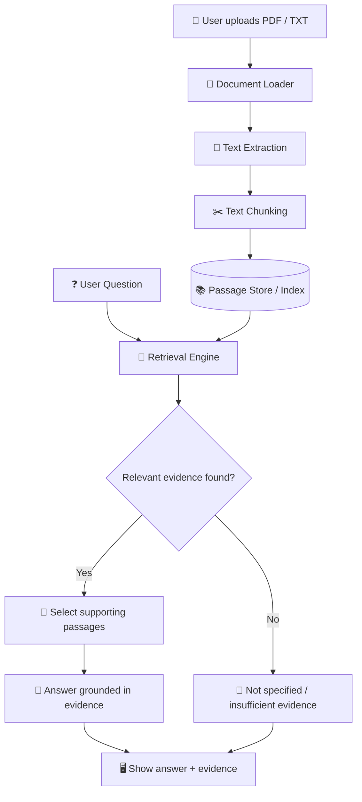
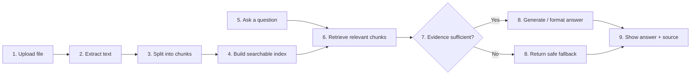

Table of Contents
- ✨ Project Overview
- ❗ Problem Statement
- 🎯 Objectives
- 🚀 Key Features
- 🧰 Technology Stack
- 🏗️ System Architecture
- 🔄 Data Flow
- ⚙️ How It Works
- 🖥️ Example User Journey
- 📂 Suggested Folder Structure
- 🛠️ Installation and Setup
- 🧪 Testing Plan
- 🔐 Privacy, Safety, and
  Limitations
- 🗺️ Development Roadmap
- ✅ Success Criteria
- 🌱 Future Enhancements
✨ Project Overview
ProofFind is an evidence-based document question-answering
application. Users upload a PDF or TXT file, ask questions in everyday
language, and receive answers supported by relevant passages from the
uploaded document.
\(!IMPORTANT\) ProofFind is designed to show its evidence. If the
document does not contain enough information to answer a question, the
application should say so instead of inventing a response.

💡 Example
A student uploads a college notice and asks:
"What is the assignment submission deadline?"

ProofFind searches the document and displays: - A concise answer, if the
document supports one. - The exact passage used as evidence. - A page
reference when page information is available. - A clear "Not specified
in this document" response if the information cannot be found
reliably.
❗ Problem Statement
Long PDFs, college notices, policies, manuals, and reports can be
difficult to search manually. A user may spend several minutes locating
one important date or rule.

Traditional keyword search may miss relevant information when the
wording differs from the user's question. General-purpose AI tools can
also produce answers that sound confident without providing evidence
from the source.

ProofFind addresses this problem by retrieving relevant text and
showing the evidence behind its answers.
🎯 Objectives
- 📄 Allow users to upload PDF and TXT documents.
- 🔍 Find passages relevant to a natural-language question.
- 💬 Present a concise answer grounded in retrieved text.
- 🧾 Display evidence so users can verify the answer.
- 🛑 Avoid guessing when the document does not support an answer.
- 🖥️ Provide a clean, easy-to-demonstrate interface.
🚀 Key Features
  Feature                 Description             Priority
  📤 Document upload      Upload PDF or TXT files MVP

  📝 Text extraction      Extract readable text   MVP
                          from documents          

  ✂️ Text chunking        Split long text into    MVP
                          smaller passages        

  🔎 Evidence retrieval   Find passages relevant  MVP
                          to the question         

  🧾 Evidence display     Show the source passage MVP
                          behind the answer       

  🚫 Safe fallback        Say when evidence is    MVP
                          insufficient            

  🧠 Semantic search      Find meaning-related    Enhancement
                          passages using
                          embeddings              

  📚 Multiple documents   Search across more than Enhancement
                          one document            

  📥 Export results       Download                Enhancement
                          question-and-answer
                      history                 
MVP means Minimum Viable Product: the smallest working version
that demonstrates the core idea.
🧰 Technology Stack
  Technology                          Purpose
  Python 3                        Main application logic

  Streamlit                       Build the interactive web interface

  pypdf                           Extract text from PDF files

  Python standard library         Read TXT files and handle basic
                                      operations

  scikit-learn TF-IDF             Baseline text retrieval for the
                                      first version

  sentence-transformers           Generate text embeddings for
  (optional)                        semantic search

  FAISS or Chroma (optional)    Store and search vector embeddings

  LLM API (optional)            Compose natural-language answers
                                      from retrieved evidence

  unittest / pytest               Test extraction, retrieval, and
                                      fallback behavior
  Git and GitHub                  Version control and project sharing
💡 Recommended approach: First build a working version with
keyword or TF-IDF search. Add embeddings, a vector database, and an
LLM only after the basic pipeline works.

🏗️ System Architecture
The application is organized as a pipeline. Each component has one
responsibility, making the project easier to build, test, and explain.

Component responsibilities
  Component                           Responsibility
  Document Loader                 Accept supported files and validate
                                      the upload

  Text Extraction                 Read text from the selected
                                      document

  Text Chunking                   Split long text into manageable,
                                      optionally overlapping passages

  Passage Store / Index           Keep passages available for
                                      searching

  Retrieval Engine                Rank passages by relevance to the
                                      question

  Evidence Selector               Choose passages that support a
                                      possible answer

  Answer Layer                    Present a concise response based on
                                      the evidence

  Fallback Handler                Avoid unsupported answers when
                                      evidence is missing

  Streamlit UI                    Display the upload control,
                                  question box, answer, and evidence
🔄 Data Flow
The data flow describes how information moves through ProofFind from
upload to answer.

Data flow explained
1. Upload: The user selects a PDF or TXT file.
2. Extract: ProofFind reads the document text. Page information
   should be retained where possible.
3. Chunk: Long text is split into smaller passages so relevant
   sections can be retrieved.
4. Index: The passages are prepared for keyword or semantic search.
5. Question: The user types a question in natural language.
6. Retrieve: The system ranks passages based on their relevance to
   the question.
7. Check evidence: The application checks whether the retrieved
   passages appear relevant enough to support a response.
8. Answer or abstain: It presents an evidence-based answer or
   explains that the document does not provide enough information.
9. Display: The user sees the response and the source passage,
   allowing them to verify it.
Important: Retrieval relevance is not a guarantee of correctness.
Users should inspect the source passage, especially for important
decisions.

⚙️ How It Works
1. Document ingestion
The user uploads a readable PDF or TXT document. The application checks
the file type and extracts its text.
2. Text chunking
The extracted text is divided into smaller passages. Overlapping chunks
can help preserve context across chunk boundaries.
3. Retrieval
For the MVP, TF-IDF or keyword-based retrieval can rank passages. In a
later version, embeddings can help find passages with similar meaning
even when the wording differs.
4. Answer generation
The simplest version can display the best matching passage and a short
answer. An optional LLM can turn the retrieved evidence into a
natural-language response, but it should be instructed to use only the
supplied evidence.
5. Evidence and fallback
The application displays the supporting text and, where available, the
page number. If relevant evidence is missing, it should respond with a
message such as:
⚠️ "I couldn't find enough evidence to answer that from this
document."

🖥️ Example User Journey
Sample document text:
"All assignments must be submitted by 15 November. Submissions should
be uploaded through the student portal."

User question: "What is the submission deadline?"

Expected result:
  Output                              Example
  Answer                              The submission deadline is 15
                                      November.

  Evidence                            "All assignments must be submitted
                                      by 15 November."

  Source                              Page number or passage location, if
                                      available

  Confidence handling                 Answer only if the retrieved
                                  evidence supports it
Second question: "What is the penalty for late submission?"

If the document does not mention a penalty, ProofFind should state that
the information is not specified in the document. The example above is
illustrative; use a real sample document for the actual demonstration.
📂 Suggested Folder Structure
proof-find/
├── app.py                  # Streamlit interface
├── document_loader.py      # PDF and TXT text extraction
├── chunker.py              # Text chunking functions
├── retriever.py            # Keyword / TF-IDF retrieval
├── answerer.py             # Evidence-based answer formatting
├── tests/
│   ├── test_chunker.py
│   └── test_retriever.py
├── sample_docs/
│   └── sample_notice.txt
├── requirements.txt        # Project dependencies
├── .gitignore              # Excludes local and secret files
└── README.md               # Project documentation
🛠️ Installation and Setup
\(!NOTE\) The commands below prepare the environment. They assume you
have created the application source files; the README does not imply
that the app is already implemented.

Step 1 --- Create a project folder
mkdir proof-find
cd proof-find
Step 2 --- Create and activate a virtual environment
macOS / Linux:
python3 -m venv .venv
source .venv/bin/activate
Step 3 --- Install the MVP dependencies
python -m pip install streamlit pypdf scikit-learn
Step 4 --- Create a dependency file
python -m pip freeze > requirements.txt
Step 5 --- Run the application
After you have implemented app.py, start the Streamlit application:
streamlit run app.py
Streamlit will provide a local URL to open in your browser.
Optional: semantic search
Once the MVP works, consider adding sentence-transformers and either
FAISS or Chroma. Choose one vector-store approach rather than adding
every tool at once.

API key safety: If you later use an LLM API, keep its key in an
environment variable or a local secrets file excluded from Git. Never
commit API keys to GitHub.
🧪 Testing Plan
  Test case                           Expected result
  Upload a readable PDF               Text is extracted

  Upload a TXT file                   Text is loaded

  Ask a question answered in the      Relevant passage is retrieved
  document                            

  Ask about information absent from   App reports insufficient evidence
  the document                        

  Upload an empty or unreadable file  App shows a clear warning

  Ask an unrelated question           App avoids presenting an irrelevant
                                      passage as a certain answer

  Process a long document             Text is chunked and searchable
  Review an answer                    Supporting evidence is visible
Scanned PDFs may require OCR (optical character recognition), which is
outside the initial MVP unless you add it.
🔐 Privacy, Safety, and Limitations
- Source verification: A retrieved passage may be relevant but can
  still be misunderstood. Users should verify important answers.
- No invented certainty: The application should provide a fallback
  when evidence is insufficient.
- PDF limitations: Basic text extraction may miss text in scanned
  pages, tables, or complex layouts.
- Retrieval limitations: Keyword search may miss passages that use
  different wording. Semantic search may improve this.
- Privacy: Avoid sending confidential documents to third-party
  APIs without authorization.
- API costs: An LLM API may have usage costs and requires secure
  key handling.
- Not professional advice: ProofFind helps locate information; it
  does not replace official or professional judgment.
🗺️ Development Roadmap
  Phase                   Work                    Deliverable
  Phase 1 --- MVP     Build upload UI and     Text appears in the app
                          PDF/TXT extraction      

  Phase 2 ---           Implement chunking and  Relevant passages
  Retrieval             TF-IDF / keyword search appear for questions

  Phase 3 ---           Show source passages    Verifiable answer flow
  Evidence              and missing-evidence
                          fallback                

  Phase 4 ---           Create sample questions Measurable retrieval
  Evaluation            and tests               behavior

  Phase 5 ---           Add embeddings and      Improved semantic
  Enhancement           optional LLM answers    search and answer
                                                  presentation
  Phase 6 ---           Polish UI and rehearse  Ready-to-show project
  Presentation          demo                    prototype
✅ Success Criteria
The first version should be considered successful when it can:
- [ ] Accept a readable PDF or TXT file.
- [ ] Extract and chunk the document text.
- [ ] Retrieve relevant passages for a prepared set of questions.
- [ ] Display supporting evidence with the answer.
- [ ] Abstain when the source does not support an answer.
- [ ] Handle empty or unreadable files with a clear message.
- [ ] Run locally using documented setup instructions.
🌱 Future Enhancements
- 🔗 Page-level citations and clickable source references.
- 🧠 Embedding-based semantic retrieval.
- 🗃️ A vector database for larger document collections.
- 📚 Search across multiple uploaded documents.
- 📊 A small evaluation dashboard to compare retrieval approaches.
- 📥 Exportable answers and source passages.
- 🔐 Local-only processing mode for privacy-sensitive documents.
👨‍💻 Skills Demonstrated
By completing ProofFind, you can demonstrate:

Python · Document Processing · Information Retrieval · Streamlit
· Testing · Embeddings (optional) · RAG Concepts ·
Responsible AI
📌 Project Status
Current status: Project proposal / implementation plan.

This README describes the intended design and workflow. Features should
only be marked as implemented after the code has been written and
tested.
::: {align="center"}
### 🔎 ProofFind
